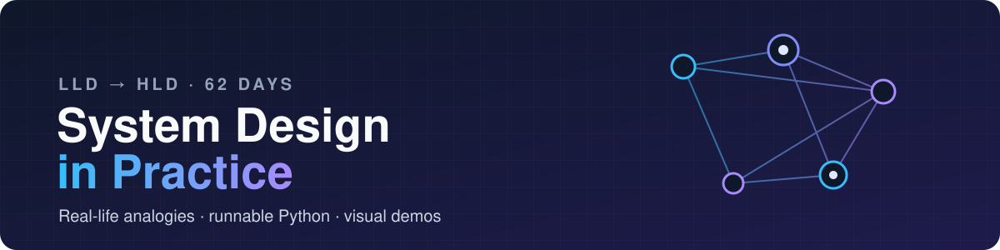

<div align="center">



<br>

[](https://github.com/vivek27kgp/system-design-in-practice/actions/workflows/tests.yml)


[](https://vivek27kgp.github.io/system-design-in-practice/)

**Learning system design by building it, one topic a day.**<br>
Every concept, from OOP to distributed consensus, comes with a real-life analogy,<br>runnable Python, tests and a visual demo.

[**Roadmap**](#%EF%B8%8F-roadmap) · [**Daily log**](#-daily-log) · [**Run it**](#%EF%B8%8F-run-it-yourself) · [**Progress**](PROGRESS.md) · [**Visual gallery**](https://vivek27kgp.github.io/system-design-in-practice/)

</div>

---

## 🧭 The method

> **If you can't explain it with a real-life analogy in two sentences, you don't understand it yet.**

| | Step | What it looks like (e.g. caching) |
|:-:|---|---|
| 🧠 | **Analogy** | Keep a water bottle on your desk instead of walking to the kitchen every time |
| ⚡ | **Tiny example** | 30 lines or fewer, one command, e.g. a `dict` in front of a slow function |
| 🛠️ | **Build + test** | A realistic version, e.g. FastAPI + Redis in front of a slow endpoint, with `pytest` |
| 👀 | **Visualise** | An animated or interactive page, diagrams, live terminal demos |
| 🚀 | **Ship** | Notes, code and visuals committed here, every day |

## 📈 Progress

```text
LLD concepts   █░░░░░░░░░░░░░░░░░░░   1 / 17
LLD problems   ░░░░░░░░░░░░░░░░░░░░   0 / 11
HLD concepts   ░░░░░░░░░░░░░░░░░░░░   0 / 24
HLD problems   ░░░░░░░░░░░░░░░░░░░░   0 / 10
─────────────────────────────────────────────
Overall        ░░░░░░░░░░░░░░░░░░░░   1 / 62
```

## 🗺️ Roadmap

<table>
<tr>
<td width="50%" valign="top">

### 🧩 Low-Level Design
**[Full plan →](LLD_ROADMAP.md)**

**Phase 1 · Concepts** (Days 1–17)<br>
OOP · class relationships · SOLID · UML<br>
GoF design patterns · concurrency

**Phase 2 · Interview problems** (Days 18–28)<br>
Parking Lot · Elevator · Splitwise<br>
BookMyShow · Vending Machine · LRU · Chess

</td>
<td width="50%" valign="top">

### 🌐 High-Level Design
**[Full plan →](HLD_ROADMAP.md)**

**Phase 3 · Concepts** (Days 29–52)<br>
Networking · load balancing · caching · databases<br>
sharding · CAP · Kafka · sagas · Raft

**Phase 4 · Interview problems** (Days 53–62)<br>
URL Shortener · WhatsApp · News Feed<br>
YouTube · Uber · Ticketmaster · Payments

</td>
</tr>
</table>

## 📅 Daily log

| Day | Topic | 🧠 Analogy | Code | Visual |
|:-:|---|---|:-:|:-:|
| 01 | **OOP pillars**: encapsulation, abstraction, inheritance, polymorphism | 🚗 A car: sealed engine, pedal, shared wheels, different horns | [📂](lld/day01_oop_pillars/) | `demo.py` |

<sub>Next up: Day 02, class relationships and composition over inheritance.</sub>

## ▶️ Run it yourself

```bash
git clone https://github.com/vivek27kgp/system-design-in-practice.git
cd system-design-in-practice
python -m venv .venv
source .venv/bin/activate        # Windows: .\.venv\Scripts\Activate.ps1
pip install -r requirements.txt

python -m pytest                          # run every test
python -m lld.day01_oop_pillars.demo      # run a day's visual demo
```

<details>
<summary><b>📂 Repository structure</b></summary>

```text
system-design-in-practice/
├── lld/                      # Low-Level Design, one package per day
│   └── dayNN_<topic>/
│       ├── README.md         # analogy → notes → diagram → interview Qs
│       ├── example.py        # the tiny example
│       ├── *.py              # the practical build
│       ├── demo.py           # visual walkthrough
│       └── test_*.py         # pytest
├── hld/                      # High-Level Design (from Day 29)
├── docs/                     # 🌐 GitHub Pages: interactive visual gallery
├── LLD_ROADMAP.md · HLD_ROADMAP.md · PROGRESS.md
└── requirements.txt · pyproject.toml
```

</details>

<details>
<summary><b>🧰 Tech stack</b></summary>

| Area | Tools |
|---|---|
| Language | Python 3.12 (`abc`, `dataclasses`, `enum`, `threading`) |
| Testing | pytest + GitHub Actions CI |
| Visuals | Mermaid diagrams · `rich` terminal demos · HTML/JS animations |
| HLD labs (later) | FastAPI · Docker Compose · Redis · Postgres · Kafka · nginx · Locust |

</details>

## 📚 References

| | Low-Level Design | High-Level Design |
|---|---|---|
| **Main path** | [awesome-low-level-design](https://github.com/ashishps1/awesome-low-level-design) | [karanpratapsingh/system-design](https://github.com/karanpratapsingh/system-design) |
| **Patterns & problems** | [refactoring.guru](https://refactoring.guru/design-patterns) | Alex Xu, *System Design Interview* Vol 1 & 2 |
| **Interview view** | [Hello Interview LLD](https://www.hellointerview.com/learn/low-level-design) | [Hello Interview](https://www.hellointerview.com/learn/system-design/in-a-hurry/introduction) |
| **Depth** | *Head First Design Patterns* | *Designing Data-Intensive Applications* (2nd ed.) |

<div align="center">

<br>

**If this helps you learn too, a ⭐ is appreciated.**

<sub>Built in public · follow along with <b>#SystemDesignInPractice</b></sub>

</div>
