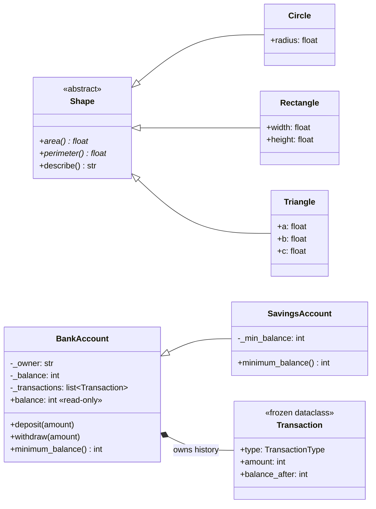

# Day 1 · OOP Pillars

> **Phase 1: LLD Concepts** · [⬅ LLD index](../README.md) · [Next: Day 2 → Class relationships](../../LLD_ROADMAP.md#week-1-foundations)

## 🧠 The idea in one analogy: a car

| Pillar | In the car | In one sentence |
|---|---|---|
| **Encapsulation** | The engine is sealed under the bonnet; you can't reach in and spin the pistons | Keep data private and change it only through methods that enforce the rules |
| **Abstraction** | You press the pedal without knowing how fuel injection works | Expose *what* something does and hide *how* |
| **Inheritance** | Every vehicle has wheels and can accelerate; a truck reuses that | A child class **is-a** parent and reuses its behaviour |
| **Polymorphism** | The same "horn" button beeps on a bike and honks on a truck | Same method call, different behaviour depending on the object |

## ⚡ Tiny example

[`example.py`](example.py) shows all 4 pillars in about 30 lines:

```bash
python -m lld.day01_oop_pillars.example
# Pulsar    horn=Beep beep!  speed=100
# Tata 407  horn=HOOONK!     speed=80     ← accelerate(100) was capped by Truck's max_speed
```

## 🛠️ Practical

| File | What it shows |
|---|---|
| [`shapes.py`](shapes.py) | **Abstraction + polymorphism.** `Shape` is an abstract contract. `Circle`, `Rectangle` and `Triangle` each implement `area()`/`perimeter()`. `total_area()` works for any shape without checking types |
| [`bank_account.py`](bank_account.py) | **Encapsulation + inheritance.** The balance is read-only and changes only via `deposit()`/`withdraw()`. `SavingsAccount` inherits everything and overrides one rule (minimum balance) |
| [`test_shapes.py`](test_shapes.py), [`test_bank_account.py`](test_bank_account.py) | 19 tests that prove the rules hold |

## 👀 Visualise

```bash
python -m lld.day01_oop_pillars.demo     # colourful step-by-step walkthrough of all 4 pillars
python -m pytest lld/day01_oop_pillars    # run the tests
```

To *see* objects and references in memory, paste [`example.py`](example.py) into [Python Tutor](https://pythontutor.com).



## 🐍 How Python does it (vs the textbook)

| Textbook idea | Python tool |
|---|---|
| Interface / abstract class | `abc.ABC` + `@abstractmethod`. You can't instantiate an `ABC` with unimplemented methods |
| `private` fields | Convention: `_name` means "internal, don't touch". There's no hard enforcement |
| Getters/setters | `@property`. A property with no setter is read-only |
| Fixed set of values | `enum.Enum` (e.g. `TransactionType.DEPOSIT`), never magic strings |
| Value objects | `@dataclass(frozen=True)`, which generates `__eq__`, `__hash__` and `__repr__` and makes the object immutable |
| Calling the parent | `super().__init__(...)` |

## 💡 Key takeaways

- **Put each rule in one place.** `withdraw()` checks `minimum_balance()`, so `SavingsAccount` changes the rule by overriding one small "hook" method instead of rewriting `withdraw()`.
- **Polymorphism removes `if/elif` type checks.** `total_area()` will work for a `Hexagon` added next year without being edited (this sets up the Open/Closed Principle on Day 4).
- **Value equality vs identity.** `Circle(2) == Circle(2)` is `True` because they're the same value. Two accounts with the same owner and balance are still *different accounts*, so they're `False`.
- **Never use `float` for money**, because `0.1 + 0.2 != 0.3`. Use `int` paise/rupees or `decimal.Decimal`.

## ⚠️ Mistakes to avoid

- Inheriting just to reuse code when the "is-a" doesn't hold. A `Stack` is **not** a `list`; it *has* one. That's Day 2's topic: composition over inheritance.
- Returning internal mutable state (e.g. the real `_transactions` list) lets callers bypass your rules. Return a copy or a tuple.
- Public mutable fields like `account.balance = -500` make encapsulation meaningless.

## 🎤 Interview questions

<details><summary><b>1. What's the difference between abstraction and encapsulation?</b></summary>

Abstraction is about **design**: showing only what matters (the `Shape` contract says "has an area"). Encapsulation is about **protection**: bundling data with the methods that guard it and hiding the internals (`_balance` changes only via `withdraw()`). Abstraction hides *complexity*; encapsulation hides *state*.
</details>

<details><summary><b>2. Abstract class vs interface? How does Python handle it?</b></summary>

An interface is a pure contract with no state. An abstract class can also hold shared state and implemented methods (like `Shape.describe()`). Python has no `interface` keyword. You use `ABC` for both, or `typing.Protocol` for structural ("duck") typing, where a class conforms just by having the right methods, without inheriting.
</details>

<details><summary><b>3. What are compile-time and runtime polymorphism? Which does Python have?</b></summary>

Compile-time polymorphism is method **overloading**: same name, different parameters, resolved by the compiler. Runtime polymorphism is method **overriding**, where the child's version is chosen at runtime based on the object. Python has only runtime polymorphism. Simulate overloading with default arguments, `*args`, or `functools.singledispatch`.
</details>

<details><summary><b>4. When is inheritance the wrong choice?</b></summary>

When the "is-a" relationship isn't true in *every* situation, or when you only want to reuse code. Example: `Square(Rectangle)` breaks if `Rectangle` allows setting the width independently (Day 4, LSP). Prefer composition (the class "has-a" helper) and keep hierarchies shallow.
</details>

<details><summary><b>5. Why make the balance read-only instead of a public field?</b></summary>

So no code anywhere can put the account into an invalid state. Every change goes through `deposit()`/`withdraw()`, which validate input, enforce the minimum balance, and record history. With a public field, you'd have to trust every caller in the codebase.
</details>

## 📚 Study alongside

- [awesome-low-level-design: OOP fundamentals](https://github.com/ashishps1/awesome-low-level-design)
- [sudoCode: LLD Primer (YouTube)](https://www.youtube.com/playlist?list=PLTCrU9sGybupCpY20eked6blbHI4zZ55k)
- [Python docs: `abc`](https://docs.python.org/3/library/abc.html) · [`dataclasses`](https://docs.python.org/3/library/dataclasses.html)
